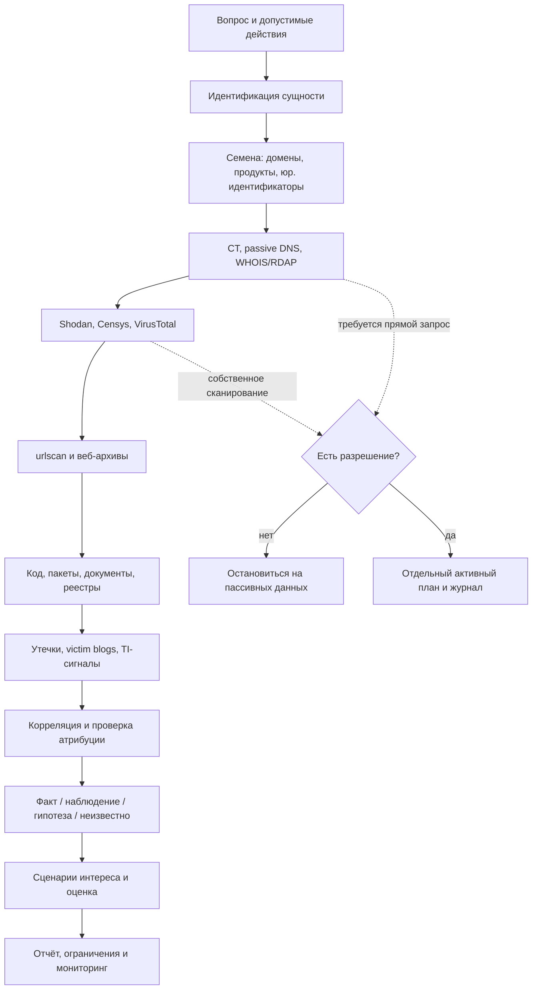

# Абстрактная цепочка исследования



## Фаза 0. Постановка вопроса

Записать:

- что именно требуется выяснить;
- временной срез;
- допустимые и запрещённые действия;
- можно ли обращаться к исследуемым узлам;
- какие данные нельзя сохранять;
- формат результата.

Выход: короткий `scope` с границами и критериями завершения.

## Фаза 1. Идентификация сущности

Собрать устойчивые идентификаторы:

- полное и краткое юридическое имя;
- регистрационный номер;
- официальный домен;
- бренды и продукты;
- официальные приложения и package IDs;
- дочерние и прежние названия.

Главная задача — не смешать одноимённые организации и чужие домены.

Выход: таблица сущностей и вариантов написания.

## Фаза 2. Формирование семян

Семена — это исходные строки для поиска:

```text
юридическое имя
бренд
домен и e-mail-домен
название продукта
регистрационный номер
package/application ID
официальные аккаунты
```

Для каждого семени указать источник. Не добавлять предполагаемый домен в список подтверждённых только потому, что он похож по названию.

## Фаза 3. Историческая инфраструктура

Порядок:

1. Certificate Transparency — имена и временные границы сертификатов.
2. Passive DNS — связи имя ↔ IP и first/last seen.
3. RDAP/WHOIS/ASN — владелец домена и сети.
4. MX/NS/TXT — внешние провайдеры и зависимые сервисы.

Выход: временная карта доменов, IP и провайдеров. На этом этапе не утверждать, что узел действует сейчас.

## Фаза 4. Наблюдаемая поверхность

Проверить найденные домены и IP в двух независимых индексах, например Shodan и Censys.

Для каждого результата записать:

- сервис и порт;
- дату последнего наблюдения;
- hostname и certificate names;
- продукт и версию, если они действительно присутствуют в баннере;
- наличие общей инфраструктуры;
- расхождения между индексами.

Варианты вывода:

- **подтверждено двумя индексами** — сильное наблюдение;
- **есть только в одном индексе** — требует осторожности;
- **есть DNS, но 0 services** — актив известен по имени, доступный сервис не подтверждён;
- **общий IP без целевого домена** — атрибуция отклонена;
- **0 results** — индекс не дал наблюдения, а не доказал отсутствие.

## Фаза 5. Веб-история

Искать только существующие снимки:

1. urlscan — недавние сканы, редиректы, IP, server, title и внешние ресурсы.
2. Wayback — изменение страниц, документов, sitemap и публичных функций во времени.
3. Поисковые индексы — упоминания и документы, не попавшие в архивы.

Отмечать смену владельца или назначения домена: старое содержимое может относиться к другому проекту.

## Фаза 6. Код, пакеты и документы

Проверить:

- точные доменные строки в публичном коде;
- официальные организации и namespace;
- реестры пакетов и контейнеров;
- PDF/DOC/XLS/PPT и их метаданные;
- официальные инструкции, changelog и release notes.

Цель — понять технологии и цепочку поставки, а не искать возможность использовать найденный секрет.

## Фаза 7. Данные, инциденты и утечки

Поиск вести по нескольким идентификаторам одновременно:

```text
"юридическое имя" + утечка
"домен" + breach
"регистрационный номер" + инцидент
"бренд" + ransomware
"продукт" + credentials
```

Результаты классифицировать:

- подтверждённый инцидент;
- заявление без подтверждения;
- информационная экспозиция;
- ошибочная атрибуция;
- совпадений не найдено.

Не скачивать пароли и базы. Для аналитического вывода достаточно метаданных, первичного подтверждения и контекста.

## Фаза 8. Корреляция

Для каждой связи ответить:

1. Почему мы считаем, что актив относится к сущности?
2. Когда связь наблюдалась?
3. Источник первичный или агрегированный?
4. Есть ли независимое подтверждение?
5. Может ли это быть shared hosting, старый владелец или однофамилец?
6. Меняет ли наблюдение сценарий или только расширяет карту?

Затем удалить дубликаты и объединить записи об одном активе во временную линию.

## Фаза 9. Сценарии интереса

Сценарий должен связывать четыре элемента:

```text
тип нарушителя → желаемый результат → интересующий актив → возможное последствие
```

Пример абстрактной формулировки:

> Финансово мотивированный злоумышленник может интересоваться учётной записью службы поддержки, если она предоставляет доступ к данным нескольких клиентов; открытые данные подтверждают роль поддержки, но не подтверждают доступность конкретной системы.

Сценарий не должен превращаться в пошаговую инструкцию атаки и не должен выдавать предполагаемый доступ за факт.

## Фаза 10. Оценка и отчёт

Сначала приводятся источники и наблюдения, затем — оценка. Это позволяет читателю проверить, откуда взялся каждый балл.

Разделить:

- устойчивую ценность цели: данные, полномочия, доверие, клиенты, влияние простоя;
- динамические сигналы: свежая экспозиция, подтверждённая утечка, KEV/CVE с совпавшей версией, заявление злоумышленника, актуальное событие.

Исторические имена, общий IP и неподтверждённые заявления сами по себе не должны резко повышать оценку.

## Фаза 11. Мониторинг

Для повторного исследования хранить:

- дату предыдущего среза;
- сохранённые запросы;
- список сущностей;
- журнал изменений;
- условия пересчёта вывода;
- источники с ограниченным доступом, которые не удалось проверить.

Новый результат сравнивать с предыдущим, а не собирать всю картину заново.
